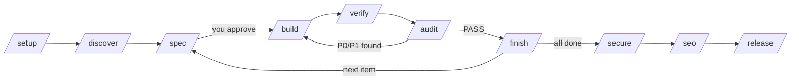

# agent-skills

**Ship real software with AI, one feature at a time.**
Spec → build → verify → cross-model review → finish. Then secure, SEO and release.
17 one-word skills for **Claude Code** and **Codex** (and any agent that reads `SKILL.md`).

---

## Quick start

```bash
# 1. install the skills (once, global)
npx skills add saidmounaim/agent-skills --all -g

# 2. inside your app (already scaffolded, git repo)
/setup        # creates plan/ and AGENTS.md rules
/discover     # interview → project plan + build plan

# 3. build features, one at a time
/spec  →  approve  →  /build  →  /verify  →  /audit  →  /finish

# 4. ship
/secure  →  /seo  →  /release

# lost? any time, any session
/next
```

In Codex, use `$name` instead of `/name` (or `/skills`). You can also just describe what you want; skills load from their descriptions.

---

## The loop



**Claude builds, Codex reviews** (or the other way round). The reviewer is always the other model, in a fresh context.

---

## Skills

### Plan
| Skill | What it does |
| --- | --- |
| `/setup` | Adds the `plan/` folder, templates and AGENTS.md rules to your app |
| `/discover` | Interviews you, writes the project plan, build plan and overview |
| `/spec` | Next build-plan item (or a bug, in fix mode) → one reviewed spec with test-first steps |

### Build
| Skill | What it does |
| --- | --- |
| `/build` | Builds the spec step by step, test first, on its own branch. Resumes where it stopped |
| `/tests` | Sets up a test runner (Vitest) or browser tests (Playwright) with one real test |
| `/ci` | One `verify` command, same locally and in GitHub Actions |

### Prove
| Skill | What it does |
| --- | --- |
| `/verify` | Proves every "Done when" with real evidence. Writes a "Try it now" guide |
| `/audit` | The other AI model reviews the work. Findings ledger + receipt tied to a commit |
| `/finish` | Final gates, archive, tick the build plan, one commit, merge only with your yes |

### Ship
| Skill | What it does |
| --- | --- |
| `/secure` | Full security pass: auth, permissions, input, secrets, dependencies, headers |
| `/seo` | Metadata, sitemap, robots, Open Graph, JSON-LD, Core Web Vitals |
| `/release` | Deploy readiness: env vars, migrations, changelog, version, rollback plan. Never deploys itself |

### Help
| Skill | What it does |
| --- | --- |
| `/next` | Where am I, what's blocked, what to run next |
| `/explain` | Walks you through a feature, a flow or a file (read-only) |
| `/diagnose` | Reproduces a bug and finds the root cause, without editing code |
| `/money` | Rules for money, tax, rounding and invoice totals (integer cents) |
| `/skillify` | Turns someone else's skill or idea into a new skill here, in your own words |

---

## What gets added to your app

```
plan/
├── project-plan.md      ← you own it: problem, users, data, stack, deploy
├── build-plan.md        ← you own it: ordered features, stable IDs
├── context/
│   ├── overview.md      ← generated context
│   ├── current.md       ← the ONE active spec
│   ├── findings.md      ← F-01… P0–P3, open → fixed → closed
│   └── review.md        ← latest review receipt
├── history/             ← finished features and fixes
└── releases/            ← release checklists
AGENTS.md                ← rules every agent follows
```

State lives in files, not chat. Stop any time, switch between Claude Code and Codex, and run `/next` to pick up.

---

## Rules every skill follows

1. One active spec. Nothing is built that isn't in it.
2. Tests first. Existing tests are never weakened to pass.
3. No claimed result without real command output.
4. Never on `main`. Never commit, merge, push or deploy without your explicit yes.
5. Open P0/P1 findings block finishing. Only you can accept a finding.
6. The reviewer is always the other model.

---

## Example: invoice app

```
/setup
/discover          → build plan: 1 Money core · 2 Auth · 3 Clients · 4 Drafts · 5 Issue + numbering · 6 PDF · 7 Payments
/tests  /ci
/spec              → "1. Money core" spec: integer cents, half-up per line, 30+ table tests
/build  /verify  /audit  /finish
... repeat for 2–7 ...
/secure  /seo  /release
```

---

## Customize

- Edit any `skills/<name>/SKILL.md`, push, and run the install command again.
- Add a skill: `/skillify <link or idea>`.
- Project-only rules go in that project's `.claude/skills/` and `.agents/skills/`.
- When an agent makes the same mistake twice, add a line to that skill's **Gotchas**.

Credits: see [CREDITS.md](CREDITS.md). Inspired by AI Blueprint (MIT), Superpowers (MIT) and the Hacker News community. License: MIT.
