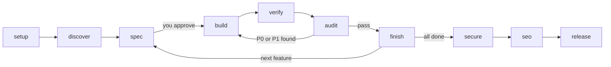

# agent-skills

**Build real software with AI, one feature at a time. Any tech stack.**

18 one-word skills for **Claude Code** and **Codex** (and any agent that reads `SKILL.md`). One model builds, the other reviews, and you approve every commit.

```
/spec  →  you approve  →  /build  →  /verify  →  /audit  →  /finish
```

---

## Quick start

**1. Install the skills** (once per machine)

Pick the agent(s) you use:

```bash
# Claude Code only
npx skills add saidmounaim/agent-skills --skill '*' -a claude-code -g -y

# Codex only
npx skills add saidmounaim/agent-skills --skill '*' -a codex -g -y

# Both
npx skills add saidmounaim/agent-skills --skill '*' -a claude-code -a codex -g -y
```

**2. Prepare your project** (once per project; it must already exist and be a git repo)

| Run | What happens |
| --- | --- |
| `/setup` | Adds the `plan/` folder and detects your stack's commands |
| `/discover` | Asks you questions, then writes the project plan and build plan |
| `/design` | UI projects only: writes `design.md` from your screens or a short brief |
| `/tests` and `/ci` | Only if you have no tests or no CI yet |

**3. Build each feature** (repeat)

| Run | What happens | You |
| --- | --- | --- |
| `/spec` | Writes a spec for the next feature, with small test-first steps | Read it, say "approve" |
| `/build` | Builds it step by step, test first | Look at each diff |
| `/verify` | Proves every "Done when" with real output | Try it yourself |
| `/audit` | The other AI model reviews it | Decide on disputed findings |
| `/finish` | Archives the spec, ticks the plan, commits and merges | Say yes to each |

**4. Ship**

```
/secure  →  /seo  →  /release
```

**Lost?** Run `/next` in any session. It reads the files and tells you the one skill to run.

In Codex, type `$spec` instead of `/spec`. You can also describe what you want in plain words; skills load by themselves.

---

## How it fits together



---

## All skills

| | Skill | What it does |
| --- | --- | --- |
| **Plan** | `/setup` | Adds `plan/`, AGENTS.md rules and a Commands table for your stack |
| | `/discover` | Interview → project plan, build plan, overview |
| | `/design` | Writes `design.md` and tokens from screens, existing UI or a brief |
| | `/spec` | Next feature or a bug → one spec with test-first steps |
| **Build** | `/build` | Implements the spec step by step; resumes where it stopped |
| | `/tests` | Sets up the test runner for your stack, or end-to-end tests |
| | `/ci` | Runs your `verify` command on every push (GitHub, GitLab, Bitbucket) |
| **Prove** | `/verify` | Real evidence for every "Done when", plus a "Try it now" guide |
| | `/audit` | Review by the other AI model; findings and a receipt |
| | `/finish` | Final gates, archive, one commit, merge with your yes |
| **Ship** | `/secure` | Security pass: sign-in, permissions, input, secrets, dependencies |
| | `/seo` | Public web pages: titles, sitemap, share previews, speed |
| | `/release` | Deploy checklist, env variables, migrations, changelog, rollback |
| **Help** | `/next` | Where am I, what is blocked, what to run next |
| | `/explain` | Walks you through a feature, a flow or a file |
| | `/diagnose` | Finds the root cause of a bug without changing code |
| | `/money` | Rules for prices, tax, rounding and invoice totals |
| | `/skillify` | Turns an idea or a repeated correction into a new skill |

---

## What gets added to your project

```
AGENTS.md              rules + Commands table (install, test, build, verify...)
CLAUDE.md              one line pointing to AGENTS.md
design.md              design rules and tokens (from /design)
plan/
├── project-plan.md    you own it: problem, users, data, stack, deploy
├── build-plan.md      you own it: ordered features with stable IDs
├── context/
│   ├── overview.md    generated summary agents read
│   ├── current.md     the ONE active spec
│   ├── findings.md    review findings: P0–P3, open → fixed → closed
│   └── review.md      latest review receipt
├── history/           finished features and fixes
├── references/        your screens and mockups
└── releases/          release checklists
```

Everything is plain Markdown in your repo. Close the session, switch from Claude Code to Codex, come back next week: `/next` picks up where you stopped.

---

## Any tech stack

No skill contains framework commands. `/setup` reads your repo, finds your stack (Node, Python, Go, Rust, PHP, Ruby, Java/Kotlin, .NET, Flutter, Elixir, monorepos), and writes one **Commands** table into AGENTS.md. Every other skill reads that table. If it guesses wrong, edit the table.

---

## The six rules

1. One spec at a time. Nothing is built that is not in it.
2. Tests first. Existing tests are never weakened to pass.
3. No result is claimed without real command output.
4. App code never changes on the default branch. Nothing is committed, merged, pushed or deployed without your yes.
5. Open P0 or P1 findings block `/finish` and `/release`. Only you can accept a finding.
6. The reviewer is a different model from the builder.

Tiny changes (a typo, a label) skip the loop: branch, change, verify, commit.

---

## Example: an invoice app

```
/setup                     Commands table for your stack
/discover                  1 Money core · 2 Auth · 3 Clients · 4 Drafts · 5 Issue + numbering · 6 PDF · 7 Payments · 8 Landing page
/design                    design.md from the screens in plan/references/
/tests   /ci

/spec                      "1. Money core": integer cents, per-line rounding, table tests
/build   /verify   /audit   /finish
...repeat for 2 to 8...

/secure   /seo   /release
```

---

## Good to know

- **Only one agent installed?** `/audit` can run in a fresh session of the same tool. It marks the review `same-model`, which is weaker.
- **A skill name clashes** with another command you use? Rename its folder and the `name:` line.
- **Working with screens?** Put them in `plan/references/` and run `/design`. `/spec` and `/verify` use them.
- **One feature at a time.** Parallel features are not supported on purpose.
- **Update:** edit a skill, push, run the install command again. Remove one with `npx skills remove <name> -g`.
- **Project-only rules** go in that project's AGENTS.md Gotchas, or its own `.claude/skills/` and `.agents/skills/`.
- **Agent made the same mistake twice?** Add a line to that skill's Gotchas.
- **Editing this repo:** run `scripts/check.sh` before you push.

Credits in [CREDITS.md](CREDITS.md). MIT license.
